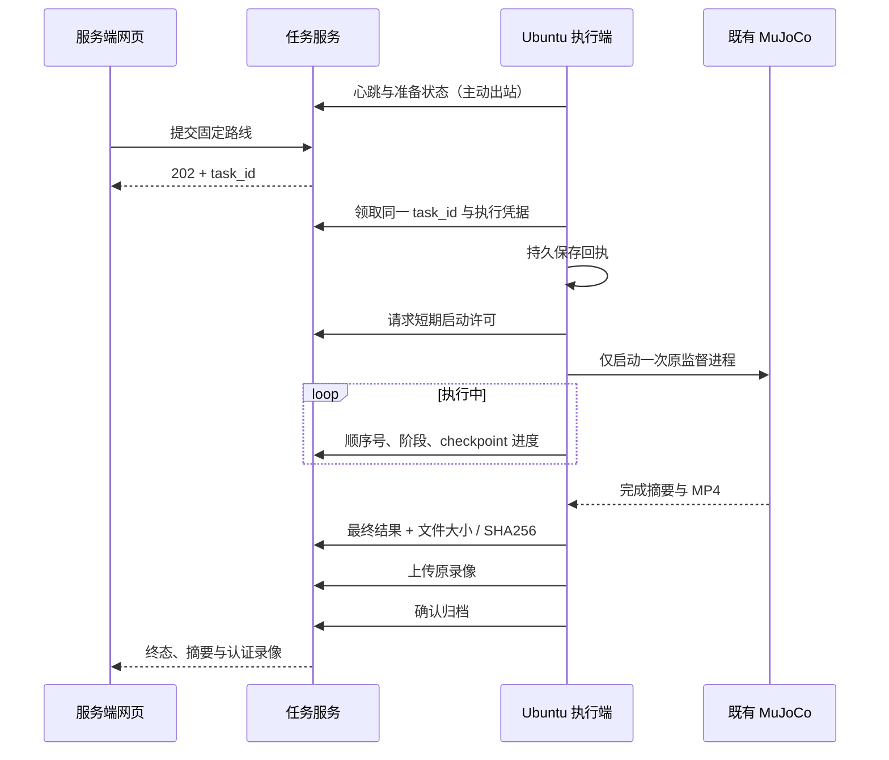

# 手动远程仿真通道

> **公开子集与执行前提：**本仓库公开服务端／执行端的 HTTP 协议与监督适配代码，未分发实际 MuJoCo 执行实现、Go2 XML／OBJ 和模型权重。下文完整启动步骤与效果描述是原私有完整环境的历史／设计参考，只有另行取得兼容外置实现和资产使用授权并配置后才能实际执行。新克隆默认不可仿真；公开副本可运行的范围见 [公开应用说明](../../docs/PUBLIC_APPLICATION.md)。

服务端接收网页任务；Ubuntu 执行端主动通过 HTTP 领取，复用现有 MuJoCo 监督进程，回传进度、结果和录像。已在同一台电脑的独立进程、独立数据目录间验证。当前未部署到华为云，也未验证跨公网连接。

## 协议能力与历史完整环境行为

- 管理员与评委使用同一服务端工作台，评委使用独立普通账号。评委共享这个演示账号及其任务记录；管理员可以查看所有记录。
- 每次只开放管理员配置的一条预设路线，默认 `checkpoints-simple`（三点、两个侧箱）；两端同时设置 `REMOTE_ROUTE_ID=checkpoints-walls` 可改为三面错位短墙。仍用原有导航、模型和录像，不增加导航算法、相机问答或实机控制。历史短墙结果见 [演示证据](../../docs/demo.md)。
- 一次一个任务，忙时拒绝、离线拒绝、不排队、不抢占、不自动重跑。上传重试只传同一个结果文件。
- 远程执行端启动期间，本机原工作台暂停接收新任务。历史仍可读；用户与评委统一在服务端操作。
- 原工作台和执行端共用同机同账户的执行锁。已有本地任务运行时，执行端不能抢占；执行子进程继承锁，避免父进程意外退出后立即开放新任务。

## 手动启动与停止（获准外置完整环境参考）

先完成 [后端安装](README.md)、[网页构建](../../apps/web/README.md)，另行准备已取得使用授权的兼容仿真源码、机器人资产和策略权重。公开范围见 [仿真说明](../../edge/go2/simulation/README.md)。以下命令不会取得或补齐缺失实现，必须先配置可用的外置路径；在满足此前提的完整环境仓库根目录执行一次：

```bash
bash cloud/backend/remote-demo.sh init
```

它从现有本地配置复用仿真解释器与模型路径，生成被 Git 忽略的 `.local/remote-demo/server.env` 和 `executor.env`；已有配置不会被覆盖。解释器路径保留 `.venv/bin/python`，不要解析成系统 Python。模型、密钥与录像不进入 Git。

两个终端分别运行：

```bash
# 终端 1：网页、账号与任务服务；无需 MuJoCo / Torch / 策略权重。
bash cloud/backend/remote-demo.sh server
```

```bash
# 终端 2：显式开放本机仿真执行；启动前确认没有本地任务。
bash cloud/backend/remote-demo.sh executor
```

打开 <http://127.0.0.1:8010>，使用 `judge@example.com`。初始评委密码在本机 `server.env` 的 `REMOTE_DEMO_PASSWORD`，管理员密码在 `FIRST_SUPERUSER_PASSWORD`；在本机编辑器查看，不发聊天、不入库。已有账号数据库时修改这些变量不会重置密码。

只启动服务端时，网页显示执行端离线，不能发起任务。执行端启动后，必要时点击网页“刷新连接”。同一执行端不要重复启动。

演示结束在**执行端终端按 Ctrl+C**：停止接任务、取消当前仿真、等待原监督进程清理，尝试回传取消结果，然后退出并恢复本机工作台准入。断网时结果保存在执行端，下次手动启动同一配置会补传，不重新仿真。服务端终端随后也可 Ctrl+C 关闭。

普通 `bash cloud/backend/run.sh` 仍使用原 `.env`、端口 `8000` 和本地执行。默认 `REMOTE_ENABLED=false`；没有自启服务、定时任务或后台守护安装。远程执行 CLI 不带 `--enable-remote` 会拒绝启动。

## 两端数据与配置

| 项目 | 服务端 | Ubuntu 执行端 |
| --- | --- | --- |
| 入口 | 现有 FastAPI 与构建后的 Vue | `python -m app.remote_agent --enable-remote` |
| 私有数据 | `.local/remote-demo/server` | `.local/remote-demo/executor` |
| 职责 | 账号、任务记录、心跳、进度、录像校验归档 | 领取、持久回执、原监督进程、原录像与补传记录 |
| 仿真依赖 | 不需要；仅需 Git 内的路线配置 | 现有隔离 Python、源码、获准策略权重 |
| 网络 | 对外提供网页/API；本地脚本仅监听 loopback | 仅主动出站，没有监听端口 |

两端不共享任务目录；应用只通过 HTTP 交换任务和文件。服务端本地演示配置故意使用不存在的仿真源码／权重路径，且未配置仿真 Python，以验证职责分离。

| 配置 | 默认值与作用 |
| --- | --- |
| `CAMPUS_ENV_FILE` | 可指定独立配置文件；原后端仍默认读取 `cloud/backend/.env` |
| `REMOTE_ENABLED` | `false`；只在任务服务端配置为 `true` |
| `REMOTE_EXECUTOR_KEY` | 两端相同的独立随机凭据，至少 32 字符；与浏览器 JWT 分开 |
| `REMOTE_SERVER_URL` | 执行端连接的服务端 origin，本地为 `http://127.0.0.1:8010` |
| `REMOTE_DEVICE_ID` / `REMOTE_ROUTE_ID` | 两端一致，默认 `ubuntu-simulation` / `checkpoints-simple` |
| `REMOTE_POLL_SECONDS` | `1` 秒一次心跳／领取／状态回传 |
| `REMOTE_OFFLINE_SECONDS` | `10` 秒未收到心跳判为离线，不把正在执行的任务判为失败 |
| `REMOTE_DISPATCH_SECONDS` | `10` 秒内没有取得启动许可则过期，需用户手动提交新任务 |
| `TASK_TIMEOUT_SECONDS` | 本地执行总时限，默认 `90` 秒；服务端值不能大于执行端允许值 |
| `REMOTE_MAX_VIDEO_BYTES` | 默认 `67108864` 字节；录像流式上传并核对大小、SHA256 与 MP4 标记 |
| `EXECUTION_LOCK_PATH` | 默认当前账户临时目录下的统一锁；原工作台与执行端必须使用同一路径 |

未来跨机连接使用带有效证书的 HTTPS origin，执行端拒绝非 loopback 的明文 HTTP、URL 内凭据和跳转。云端监听、证书、网络、账号资源和费用需在部署时实际配置与验证；当前脚本不会配置这些，也不会创建 ECS、OBS 或其他云资源。

## 任务与断线语义



`remote_phase` 为 `WAITING → RUNNING → UPLOADING → DELIVERED`；`remote_pending=true` 时仍占用任务名额。本地执行结束、文件尚未核验时，网页显示回传中，不提前发布成功录像。全部 checkpoint 按顺序完成且明确无碰撞／跌倒才允许成功。

启动许可响应丢失时，执行端保守报告 `START_UNCONFIRMED`，不启动仿真、不自动尝试第二次。重复领取、重复回报和归档应答丢失均使用原任务号与持久回执去重。后台不会因网络恢复重新移动或重新跑仿真。

网络中断时，已启动的仿真继续受本地 90 秒总时限监督，保存原结果；服务端显示离线／结果待确认，并继续占用单任务名额。恢复连接后回报原任务并补传原录像。若用户在断网时取消，需等执行端收到请求和结束确认；已经完成的任务保留真实完成结果。

主动停止**服务端**等同于连接中断，不会取消独立执行端的仿真。主动停止**执行端**会取消本地任务。取消／超时留下的未完成录像不公开。监督进程意外丢失时沿用 `requires_operator_review`，保留记录并阻止新任务，须本机检查，不提供远程按钮绕过。

服务器使用单 worker 和独立数据目录；不要删除尚未交付的执行端目录、回执或 session 文件，否则无法用原记录恢复。执行端停止后，网页可能仍保留上次显示，点击“刷新连接”获取当前准入状态。

## 复用的接口与新增协议

浏览器继续使用现有登录、`/tasks`、状态、事件、历史、取消和带 Bearer 的 `/video`，没有第二套网页或调度框架。普通账号仍只能读取自己的任务，不能使用执行端 API。

新增 `/api/v1/executor`，仅接受独立执行端凭据：

| POST 路径 | 行为 |
| --- | --- |
| `/poll` | 心跳、准备状态、领取原任务或恢复未交付任务 |
| `/tasks/{id}/start` | 检查 session、任务凭据和短期启动窗口 |
| `/tasks/{id}/report` | 按递增顺序号回报；阶段不倒退，结果待文件核验 |
| `/tasks/{id}/video` | 流式接收原 MP4，超限／不完整／哈希不符不交付 |
| `/tasks/{id}/complete` | 幂等发布已核验结果 |
| `/disconnect` | 主动关闭准入，取消尚未启动的交接 |

每个任务另有随机执行凭据和持久 session；凭据只进入请求头／JSON，不放 URL。配置和日志均在本机私有目录，仓库只保留脱敏验证报告。验证命令与实际证据见 [REMOTE_VALIDATION.md](REMOTE_VALIDATION.md)。
